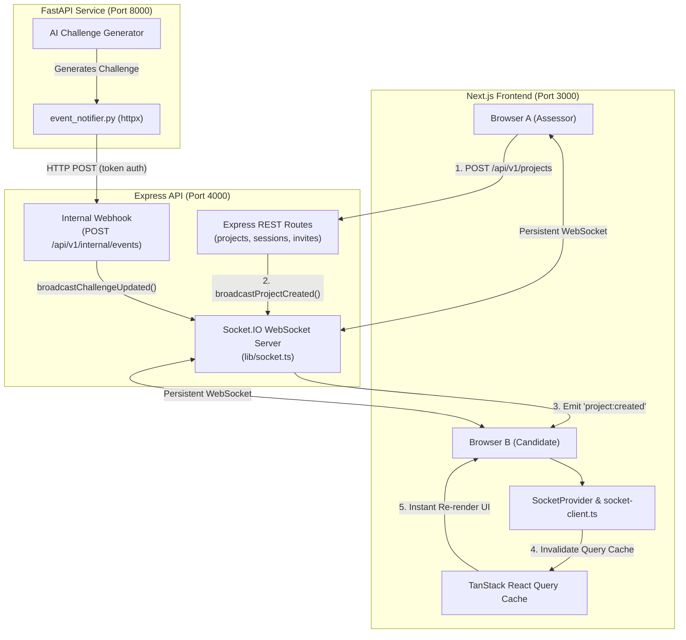

# 🚀 Complete WebSocket Real-Time Guide: Layer-by-Layer & Code-by-Code

Welcome! This guide is written specifically to help you understand **how real-time updates work** in this application from first principles, explained simply with analogies, diagrams, and line-by-line code breakdowns.

---

## 📑 Table of Contents

1. [The Big Picture: What is WebSocket and Why Do We Need It?](#1-the-big-picture-what-is-websocket-and-why-do-we-need-it)
2. [High-Level Architecture Diagram](#2-high-level-architecture-diagram)
3. [Layer 1: The Express WebSocket Hub (Backend Server)](#3-layer-1-the-express-websocket-hub-backend-server)
   - [3.1 Binding Express with WebSockets (`server.ts`)](#31-binding-express-with-websockets-serverts)
   - [3.2 The Socket Manager &amp; Broadcast Hub (`lib/socket.ts`)](#32-the-socket-manager--broadcast-hub-libsocketts)
   - [3.3 How Routes Trigger Broadcasts (`project.routes.ts` &amp; `session.routes.ts`)](#33-how-routes-trigger-broadcasts)
   - [3.4 The FastAPI Internal Bridge (`routes/internal.routes.ts`)](#34-the-fastapi-internal-bridge-routesinternalroutests)
4. [Layer 2: The FastAPI AI Microservice (Background Producer)](#4-layer-2-the-fastapi-ai-microservice-background-producer)
   - [4.1 Why FastAPI Doesn&#39;t Connect Directly to Browsers](#41-why-fastapi-doesnt-connect-directly-to-browsers)
   - [4.2 The Event Notifier (`event_notifier.py`)](#42-the-event-notifier-event_notifierpy)
   - [4.3 Firing Events in Background Tasks (`challenges.py`)](#43-firing-events-in-background-tasks-challengespy)
5. [Layer 3: The Next.js Frontend (Browser Client)](#5-layer-3-the-nextjs-frontend-browser-client)
   - [5.1 The Singleton Client (`src/lib/socket/socket-client.ts`)](#51-the-singleton-client-srclibsocketsocket-clientts)
   - [5.2 The Heart of Real-Time: Context &amp; Query Invalidation (`src/context/socket-context.tsx`)](#52-the-heart-of-real-time-context--query-invalidation-srccontextsocket-contexttsx)
   - [5.3 Why &#34;Query Invalidation&#34; Beats Manual `setState`](#53-why-query-invalidation-beats-manual-setstate)
   - [5.4 Project Rooms Hook (`useProjectRoom`)](#54-project-rooms-hook-useprojectroom)
   - [5.5 Registering the Provider (`src/components/providers/index.tsx`)](#55-registering-the-provider-srccomponentsprovidersindextsx)
6. [Layer 4: UI Reactions &amp; Visual Feedback](#6-layer-4-ui-reactions--visual-feedback)
   - [6.1 The Live Pulse Indicator (`sidebar-footer.tsx`)](#61-the-live-pulse-indicator-sidebar-footertsx)
   - [6.2 Auto-Updating Modals (`project-share-modal.tsx`)](#62-auto-updating-modals-project-share-modaltsx)
7. [Full End-to-End Walkthrough: What Happens When an Assessor Creates a Project?](#7-full-end-to-end-walkthrough)
8. [Summary Cheat Sheet](#8-summary-cheat-sheet)

---

## 1. The Big Picture: What is WebSocket and Why Do We Need It?

### The Traditional HTTP Problem (The "Ordering Food" Analogy)

Imagine traditional HTTP communication like asking a waiter:

1. **Browser (Client):** *"Is my food ready yet?"* (HTTP Request)
2. **Server:** *"No, wait."* (HTTP Response)
3. 5 seconds later...
4. **Browser:** *"Is my food ready yet?"*
5. **Server:** *"Yes, here it is."*

This is called **polling**. If you have two users—User A (Assessor) and User B (Candidate):

- When User A creates a new project, User B **cannot see it** unless User B manually clicks "Refresh" (F5) or the browser keeps spamming the server every 5 seconds asking *"Did anything change?"*.
- This wastes server CPU, consumes bandwidth, and feels slow.

### The WebSocket Solution (The "Walkie-Talkie" Analogy)

A WebSocket is like giving the waiter and the customer a **walkie-talkie**:

1. When the browser opens the page, it connects to the server and leaves the channel open.
2. The browser doesn't have to keep asking.
3. The instant User A creates a project, the server speaks into the walkie-talkie:
   > 📢 *"Attention all browsers! Project 'public 1' was just created!"*
   >
4. User B's browser immediately hears the message and updates the screen instantly without any page refresh!

---

## 2. High-Level Architecture Diagram

Here is how the three parts of our application connect:



---

## 3. Layer 1: The Express WebSocket Hub (Backend Server)

Express is the **central command station** for all real-time communication. All frontend clients maintain their WebSocket connections directly with Express on port 4000.

### 3.1 Binding Express with WebSockets (`server.ts`)

File: `MockPrep_Express/src/server.ts`

#### Why do we need this?

Usually, an Express app runs via `app.listen(PORT)`. But WebSockets do **not** use standard HTTP request-response cycles. They require raw access to the underlying Node.js TCP network server to "upgrade" an HTTP connection to a persistent WebSocket connection.

#### The Code:

```typescript
import http from "node:http"
import { app } from "./app"
import { env } from "./config/env"
import { initSocketServer, closeSocketServer } from "./lib/socket"

// 1. We create a standard Node HTTP server and pass our Express app into it
const httpServer = http.createServer(app)

// 2. We attach the Socket.IO WebSocket server to this same HTTP server!
initSocketServer(httpServer)

// 3. We listen on port 4000
httpServer.listen(env.PORT, () => {
  console.log(`[Server] Express API running on port ${env.PORT}`)
})

// 4. Graceful shutdown handler
const shutdown = () => {
  closeSocketServer() // Closes all active WebSocket connections cleanly
  httpServer.close(() => {
    process.exit(0)
  })
}
process.on("SIGINT", shutdown)
process.on("SIGTERM", shutdown)
```

- **`http.createServer(app)`**: Creates the raw HTTP server that handles incoming network traffic.
- **`initSocketServer(httpServer)`**: Socket.IO piggybacks on port 4000. Next.js can send normal REST API calls to `http://localhost:4000` **AND** connect via WebSockets to `ws://localhost:4000` on the exact same port!

---

### 3.2 The Socket Manager & Broadcast Hub (`lib/socket.ts`)

File: `MockPrep_Express/src/lib/socket.ts`

This file is the brain of our WebSocket server. It defines:

1. **CORS rules** (allowing Next.js from `http://localhost:3000` to connect).
2. **Rooms** (so messages only go where they belong).
3. **Broadcast functions** (convenient functions other routes can call).

#### Code Breakdown:

```typescript
import { Server as HttpServer } from "node:http"
import { Server as SocketIOServer, Socket } from "socket.io"
import { env } from "../config/env"

// Singleton instance stored in memory
let ioInstance: SocketIOServer | null = null

// Constant event names to prevent typos across the app
export const REALTIME_EVENTS = {
  PROJECT_CREATED: "project:created",
  PROJECT_UPDATED: "project:updated",
  PROJECT_DELETED: "project:deleted",
  INVITE_UPDATED: "invite:updated",
  SESSION_UPDATED: "session:updated",
  CHALLENGE_UPDATED: "challenge:updated",
  BOOKMARK_UPDATED: "bookmark:updated",
} as const
```

#### What is a "Room" in Socket.IO?

Imagine rooms like radio channels:

- If a message is for everyone (e.g., a new public project), we broadcast to the channel called `"public"`.
- If a message is private to Candidate John, we broadcast only to channel `"user:john_123"`.
- If a message is for candidates viewing Project #42, we broadcast to channel `"project:42"`.

Here is how connections and rooms are handled in `initSocketServer`:

```typescript
export function initSocketServer(server: HttpServer): SocketIOServer {
  if (ioInstance) return ioInstance

  // 1. Configure Socket.IO with CORS
  ioInstance = new SocketIOServer(server, {
    cors: {
      origin: [env.CORS_ORIGIN, "http://localhost:3000"],
      methods: ["GET", "POST"],
      credentials: true,
    },
    pingInterval: 25000, // Heartbeat to keep connection alive
    pingTimeout: 20000,
  })

  // 2. When any browser connects:
  ioInstance.on("connection", (socket: Socket) => {
    // Automatically join the public channel
    socket.join("public")

    // If the browser tells us who the logged-in user is, join their personal room
    socket.on("auth:identify", (userId: string) => {
      if (typeof userId === "string" && userId.trim()) {
        socket.join(`user:${userId.trim()}`)
      }
    })

    // If the browser opens a project page, join that project's room
    socket.on("join:project", (projectId: string) => {
      if (typeof projectId === "string" && projectId.trim()) {
        socket.join(`project:${projectId.trim()}`)
      }
    })

    // If the browser closes that page, leave that project's room
    socket.on("leave:project", (projectId: string) => {
      if (typeof projectId === "string" && projectId.trim()) {
        socket.leave(`project:${projectId.trim()}`)
      }
    })
  })

  return ioInstance
}
```

#### The Broadcast Helpers:

Instead of writing raw socket code inside every controller, we created clean helper functions:

```typescript
// Sends to EVERY connected user
export function broadcastProjectCreated(project: Record<string, unknown>): void {
  if (!ioInstance) return
  ioInstance.emit(REALTIME_EVENTS.PROJECT_CREATED, { project })
}

// Sends to anyone looking at this specific project AND global watchers
export function broadcastInviteUpdated(projectId: string, invite: Record<string, unknown>): void {
  if (!ioInstance) return
  ioInstance.to(`project:${projectId}`).emit(REALTIME_EVENTS.INVITE_UPDATED, { projectId, invite })
  ioInstance.emit(REALTIME_EVENTS.INVITE_UPDATED, { projectId, invite })
}

// Sends to the specific candidate and the project's assessor
export function broadcastSessionUpdated(session: Record<string, unknown>): void {
  if (!ioInstance) return
  const projectId = session.projectId as string | undefined
  const candidateId = session.candidateId as string | undefined

  if (projectId) {
    ioInstance.to(`project:${projectId}`).emit(REALTIME_EVENTS.SESSION_UPDATED, { session })
  }
  if (candidateId) {
    ioInstance.to(`user:${candidateId}`).emit(REALTIME_EVENTS.SESSION_UPDATED, { session })
  }
  ioInstance.emit(REALTIME_EVENTS.SESSION_UPDATED, { session })
}
```

---

### 3.3 How Routes Trigger Broadcasts

When someone hits a normal REST API endpoint to modify data, we save to PostgreSQL and **immediately call the broadcast helper**.

#### Example 1: Creating a Project (`project.routes.ts`)

```typescript
projectRouter.post("/", requireAuth, requireRole("assessor"), async (req, res, next) => {
  // 1. Save new project into database
  const project = await createProjectInDatabase(...)

  // 2. Format response object
  const responseData = toProjectResponse(project)

  // 3. BROADCAST TO ALL WEBSOCKET CLIENTS!
  broadcastProjectCreated(responseData)

  // 4. Return HTTP 201 to the user who clicked 'Create'
  res.status(201).json(responseData)
})
```

#### Example 2: Candidate Joins Session (`session.routes.ts`)

```typescript
sessionRouter.post("/join", requireAuth, async (req, res, next) => {
  // 1. Candidate enters invite code
  const result = await joinSessionViaCode(...)
  const fullSession = await findSessionById(result.session.id)

  const responseData = toSessionResponse(fullSession)

  // 2. BROADCAST SESSION EVENT!
  // The Assessor's screen instantly shows: "Candidate Accepted & Session Started"!
  broadcastSessionUpdated(responseData)

  res.status(201).json(responseData)
})
```

---

### 3.4 The FastAPI Internal Bridge (`routes/internal.routes.ts`)

File: `MockPrep_Express/src/routes/internal.routes.ts`

#### Why do we need this?

FastAPI is running separately on port 8000. It doesn't have direct access to Express's memory. When FastAPI finishes generating an AI coding challenge, it needs a way to tell Express: *"Hey Express, tell the connected browsers that Challenge #5 is ready!"*.

Express exposes an internal webhook endpoint:
`POST /api/v1/internal/events`

```typescript
export const internalRouter = Router()

internalRouter.post("/events", async (req: Request, res: Response, next: NextFunction) => {
  try {
    // 1. Security Check: Only allow requests holding our secret internal token!
    const token = req.headers["x-internal-token"]
    if (env.INTERNAL_SERVICE_TOKEN && token && token !== env.INTERNAL_SERVICE_TOKEN) {
      throw createAppError("Unauthorized internal event notification", 401)
    }

    const { event, payload } = req.body

    const io = getIO()
    if (io) {
      // 2. Route the event to the correct broadcast helper
      if (event === "challenge:updated" && payload?.projectId) {
        broadcastChallengeUpdated(payload.projectId, payload.challenge || payload)
      } else if (event === "session:updated" && payload?.session) {
        broadcastSessionUpdated(payload.session)
      } else {
        io.emit(event, payload)
      }
    }

    res.status(200).json({ success: true, broadcasted: Boolean(io) })
  } catch (error) {
    next(error)
  }
})
```

---

## 4. Layer 2: The FastAPI AI Microservice (Background Producer)

FastAPI (Port 8000) handles intensive Python tasks like AI challenge generation, code evaluation, and LLM orchestration.

### 4.1 Why FastAPI Doesn't Connect Directly to Browsers

If Next.js had to open one WebSocket to Express AND another WebSocket to FastAPI:

- The browser would have to manage 2 separate socket connections.
- Double firewall issues, double authentication, and complex sync logic.

**Better Solution:** All browsers connect ONLY to Express. When FastAPI has news, it sends a quick HTTP POST to Express, and Express relays it through the existing WebSocket.

### 4.2 The Event Notifier (`event_notifier.py`)

File: `MockPrep_FastAPI/app/utils/event_notifier.py`

```python
import logging
import httpx
from app.core.config import settings

logger = logging.getLogger(__name__)

async def notify_express_event(event: str, payload: dict) -> bool:
    """
    Sends an internal real-time event to the Express Socket.IO gateway
    so it can be broadcast to connected clients in real time.
    """
    url = f"{settings.EXPRESS_API_URL}/api/v1/internal/events"
    headers = {
        "Content-Type": "application/json",
        "x-internal-token": settings.INTERNAL_SERVICE_TOKEN,
    }
    body = {
        "event": event,
        "payload": payload,
    }
    try:
        # Quick non-blocking HTTP POST to Express
        async with httpx.AsyncClient(timeout=4.0) as client:
            response = await client.post(url, json=body, headers=headers)
            return response.status_code == 200
    except Exception as exc:
        logger.warning("Could not forward real-time event to Express: %s", exc)
        return False
```

### 4.3 Firing Events in Background Tasks (`challenges.py`)

File: `MockPrep_FastAPI/app/api/internal/v1/endpoints/challenges.py`

When Express calls FastAPI to queue a challenge generation:

```python
@router.post(CHALLENGE_PATHS.GENERATE)
async def generate_challenge(payload: ChallengeGenerateRequest, ...):
    # 1. Create the job record
    job = ChallengeJobResponse(...)
    _jobs_db[job_id] = job

    # 2. Fire-and-forget real-time notification to Express!
    # Using asyncio.create_task ensures this runs in the background 
    # without delaying the HTTP response!
    asyncio.create_task(
        notify_express_event(
            "challenge:updated",
            {
                "projectId": payload.project_id,
                "challenge": job.model_dump(mode="json"),
            },
        )
    )

    return job
```

---

## 5. Layer 3: The Next.js Frontend (Browser Client)

This is where the magic happens on the user's screen.

### 5.1 The Singleton Client (`src/lib/socket/socket-client.ts`)

File: `src/lib/socket/socket-client.ts`

#### Why do we need this?

Next.js runs code on **both** the Server (during SSR - Server Side Rendering) and the Client (in the browser).
WebSockets **only exist in browsers**. If Node.js tries to open a browser WebSocket during SSR, the app will crash with `window is not defined`.

```typescript
import { io, Socket } from "socket.io-client"

const SOCKET_SERVER_URL =
  process.env.NEXT_PUBLIC_EXPRESS_API_URL || "http://localhost:4000"

let socketInstance: Socket | null = null

export function getSocket(): Socket | null {
  // 1. SSR Protection: If running on server, do NOTHING
  if (typeof window === "undefined") {
    return null
  }

  // 2. Singleton Pattern: Ensure we only ever open ONE connection per browser tab
  if (!socketInstance) {
    socketInstance = io(SOCKET_SERVER_URL, {
      autoConnect: true,
      withCredentials: true,
      reconnection: true,             // Automatically reconnect if WiFi drops
      reconnectionAttempts: Infinity, // Keep trying
      reconnectionDelay: 1000,        // Wait 1 second before retrying
      reconnectionDelayMax: 5000,
      timeout: 20000,
      transports: ["websocket", "polling"], // Try WebSocket first, fallback to polling
    })
  }

  return socketInstance
}
```

---

### 5.2 The Heart of Real-Time: Context & Query Invalidation (`src/context/socket-context.tsx`)

File: `src/context/socket-context.tsx`

This file is the most important piece on the frontend. It connects the **WebSocket events** directly into **TanStack React Query**.

```typescript
"use client"

import * as React from "react"
import { useUser } from "@clerk/nextjs"
import { useQueryClient } from "@tanstack/react-query"
import { Socket } from "socket.io-client"
import { getSocket } from "@/lib/socket/socket-client"
import { queryKeys } from "@/lib/query/query-keys"

export function SocketProvider({ children }: { children: React.ReactNode }) {
  const [isConnected, setIsConnected] = React.useState(false)
  const { user, isSignedIn } = useUser()
  const queryClient = useQueryClient()
  const socketRef = React.useRef<Socket | null>(null)

  React.useEffect(() => {
    const socket = getSocket()
    if (!socket) return

    socketRef.current = socket

    // Connection lifecycle
    const onConnect = () => {
      setIsConnected(true)
      // When connected, tell the server who we are so we join user:${userId}
      if (isSignedIn && user?.id) {
        socket.emit("auth:identify", user.id)
      }
    }

    const onDisconnect = () => setIsConnected(false)

    socket.on("connect", onConnect)
    socket.on("disconnect", onDisconnect)

    // =========================================================================
    // Real-Time Listeners: What to do when an event arrives
    // =========================================================================

    // 1. When a project is created, updated, or deleted
    const onProjectEvent = () => {
      // Tell React Query: "All cached project lists are now dirty! Refetch them!"
      queryClient.invalidateQueries({ queryKey: queryKeys.projects.all })
    }

    // 2. When invites or share links change
    const onInviteUpdated = (data?: { projectId?: string }) => {
      queryClient.invalidateQueries({ queryKey: ["project-invites"] })
      if (data?.projectId) {
        queryClient.invalidateQueries({ queryKey: ["project-invites", data.projectId] })
      }
      queryClient.invalidateQueries({ queryKey: queryKeys.projects.all })
    }

    // 3. When a candidate joins, starts, or finishes a session
    const onSessionUpdated = (data?: { session?: { id?: string; projectId?: string } }) => {
      queryClient.invalidateQueries({ queryKey: queryKeys.sessions.all })
      if (data?.session?.id) {
        queryClient.invalidateQueries({ queryKey: queryKeys.sessions.detail(data.session.id) })
      }
    }

    // Register listeners on the socket
    socket.on("project:created", onProjectEvent)
    socket.on("project:updated", onProjectEvent)
    socket.on("project:deleted", onProjectEvent)
    socket.on("invite:updated", onInviteUpdated)
    socket.on("session:updated", onSessionUpdated)

    // Cleanup listeners when component unmounts
    return () => {
      socket.off("connect", onConnect)
      socket.off("disconnect", onDisconnect)
      socket.off("project:created", onProjectEvent)
      socket.off("project:updated", onProjectEvent)
      socket.off("project:deleted", onProjectEvent)
      socket.off("invite:updated", onInviteUpdated)
      socket.off("session:updated", onSessionUpdated)
    }
  }, [queryClient, isSignedIn, user?.id])

  // Provide socket context to the rest of the application
  ...
}
```

---

### 5.3 Why "Query Invalidation" Beats Manual `setState`

When building real-time apps, beginners often make this mistake:

> *"When a WebSocket message comes in, I will push the new project directly into a React `useState` array!"*

#### Why is that dangerous?

1. **Race Conditions:** What if two assessors create a project at the exact same millisecond? The state can get out of order.
2. **Filtering/Pagination Mismatch:** If the user is on page 2 or filtering by "Intermediate Web", blindly appending to an array corrupts the view.
3. **Ghost Data:** What if the project was created as private, but pushed into a public list?

#### Why `queryClient.invalidateQueries()` is superior:

- Instead of manually messing with arrays, the WebSocket simply acts as a **"Tap on the shoulder"**.
- It tells React Query: *"Something changed in projects! Refetch whatever the user is currently looking at!"*.
- TanStack Query immediately and silently re-executes the exact query for that page in the background (with the user's active search terms, pagination, and role).
- The UI transitions smoothly with **zero race conditions, zero state drift, and 100% data consistency**!

---

### 5.4 Project Rooms Hook (`useProjectRoom`)

When an Assessor opens the **Share Modal** or the **Project Detail** page, we want them to receive high-frequency updates specifically for that project (e.g. candidates joining, token rotated).

In `src/context/socket-context.tsx`:

```typescript
export function useProjectRoom(projectId: string | undefined) {
  const { joinProjectRoom, leaveProjectRoom } = useSocket()

  React.useEffect(() => {
    if (!projectId) return

    // 1. Tell Express: "I am viewing project 123, put me in room 'project:123'"
    joinProjectRoom(projectId)

    // 2. When leaving the page, tell Express: "I am leaving, remove me from room 'project:123'"
    return () => {
      leaveProjectRoom(projectId)
    }
  }, [projectId, joinProjectRoom, leaveProjectRoom])
}
```

---

### 5.5 Registering the Provider (`src/components/providers/index.tsx`)

File: `src/components/providers/index.tsx`

We place `<SocketProvider>` inside `<QueryProvider>` so it has access to `useQueryClient()`, and wrap it around the rest of the application:

```tsx
export function AppProviders({ children }: AppProvidersProps) {
  return (
    <ThemeProvider ...>
      <QueryProvider>
        <SocketProvider>
          <UserRoleProvider>
            {children}
          </UserRoleProvider>
        </SocketProvider>
      </QueryProvider>
    </ThemeProvider>
  )
}
```

---

## 6. Layer 4: UI Reactions & Visual Feedback

### 6.1 The Live Pulse Indicator (`sidebar-footer.tsx`)

File: `src/components/layout/sidebar/sidebar-footer.tsx`

Users should know that their connection is live. We use the `useSocket()` hook in the sidebar footer:

```tsx
"use client"

import { useSocket } from "@/context/socket-context"

export function SidebarFooter() {
  const { isConnected } = useSocket() // Reads live connection state!

  return (
    <div className="shrink-0 mt-auto p-4 border-t border-sidebar-border text-xs text-muted-foreground bg-sidebar">
      <div className="flex items-center justify-between">
        <span className="flex items-center gap-1.5 font-medium">
          {/* Pulsing emerald green dot when connected, amber when connecting */}
          <span
            className={`inline-block size-2 rounded-full transition-colors ${
              isConnected ? "bg-emerald-500 animate-pulse" : "bg-amber-500"
            }`}
            title={isConnected ? "Real-time sync connected" : "Connecting..."}
          />
          <span className="text-[11px] text-foreground/80">
            {isConnected ? "Live Sync Active" : "Connecting..."}
          </span>
        </span>
        <span className="text-[10px] text-muted-foreground/60">Engine v1.0</span>
      </div>
    </div>
  )
}
```

---

### 6.2 Auto-Updating Modals (`project-share-modal.tsx`)

File: `src/features/projects/components/project-share-modal.tsx`

In the Assessor's Share Modal, there is a table showing candidates who received invites and their current status (`Sent`, `Accepted`, `In Progress`, `Completed`).

By adding one line:

```tsx
export function ProjectShareModal({ project, open, onOpenChange }: ProjectShareModalProps) {
  // Automatically subscribe to this project's room while the modal is open!
  useProjectRoom(open && project?.id ? project.id : undefined)
  ...
}
```

When a candidate accepts an invite or completes a test in another browser:

1. Express calls `broadcastSessionUpdated` or `broadcastInviteUpdated`.
2. Socket.IO emits the event into room `project:${project.id}`.
3. The open modal hears the event and invalidates `["project-invites", project.id]`.
4. The candidate's status badge in the table flips from **"Sent"** to **"In Progress"** live on the Assessor's screen!

---

## 7. Full End-to-End Walkthrough

Let's follow one complete action step-by-step:

### Scenario: Assessor creates a new Public Project

1. **Assessor on Browser A** fills out the "Create Project" form on `/projects/new` and clicks **Submit**.
2. **Next.js on Browser A** sends `POST http://localhost:4000/api/v1/projects`.
3. **Express Server (Port 4000)** receives the request:
   - Authenticates the user (verifies Assessor role).
   - Inserts the new project into PostgreSQL Neon DB.
   - Calls `broadcastProjectCreated(responseData)` in `lib/socket.ts`.
   - Sends HTTP `201 Created` back to Browser A.
4. **Socket.IO Server** in Express looks at all connected clients and broadcasts:
   - Event: `"project:created"`
   - Target: Room `"public"`
5. **Candidate on Browser B** is sitting on `/discover` reading project cards:
   - Browser B's Socket.IO client receives `"project:created"`.
   - `SocketProvider` on Browser B runs:
     `queryClient.invalidateQueries({ queryKey: queryKeys.projects.all })`
6. **React Query on Browser B**:
   - Sees that `/discover` is actively displaying a query matching `queryKeys.projects.all`.
   - Silently fetches the latest public projects from Express in the background.
7. **The Screen Updates**:
   - The new project card appears on Browser B's screen instantly without refreshing the page!

---

## 8. Summary Cheat Sheet

| Question                                       | Answer                                                                                                                                                                          |
| :--------------------------------------------- | :------------------------------------------------------------------------------------------------------------------------------------------------------------------------------ |
| **Where does Socket.IO run?**            | In Express (`MockPrep_Express`) attached to the Node `httpServer` on port 4000.                                                                                             |
| **Where does the client connect?**       | From Next.js (`src/lib/socket/socket-client.ts`) to `http://localhost:4000`.                                                                                                |
| **How does FastAPI talk to WebSockets?** | FastAPI sends an internal HTTP POST to `POST /api/v1/internal/events` with a secret header token, and Express relays it.                                                      |
| **How does the frontend update?**        | Via **TanStack React Query Invalidation** (`queryClient.invalidateQueries`). This prevents race conditions and state bugs.                                              |
| **What are rooms?**                      | Virtual channels (`"public"`, `"user:${id}"`, `"project:${id}"`) to prevent sending private data to unauthorized clients.                                                 |
| **How to make any component real-time?** | If it uses a query like `useProjects()` or `useSessions()`, it is **already real-time**! The `SocketProvider` automatically invalidates queries when events arrive. |
