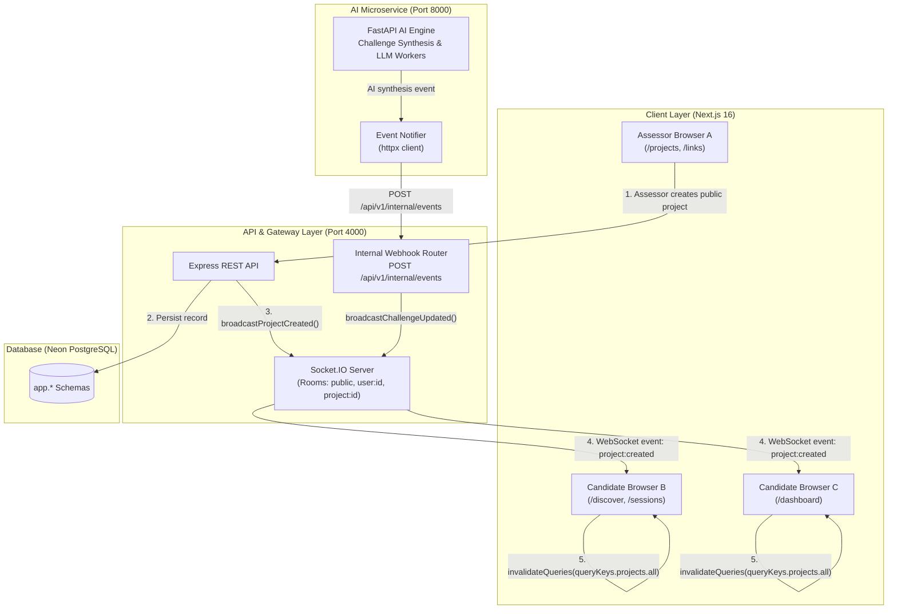

# Real-Time Synchronized Architecture Specification

## 1. Overview & System Design

MockPrep is equipped with an end-to-end, low-latency real-time synchronization layer powered by **Socket.IO** and **TanStack React Query Cache Invalidation**. 

Whenever an Assessor or Candidate performs any action (e.g., publishing a project, toggling public candidate links, joining or completing an assessment session, or generating AI challenges), the event is instantly dispatched over WebSockets. Active clients invalidate their corresponding cached queries, triggering immediate, seamless UI re-renders across all connected browsers **without manual page refreshes or stale state drift**.

---

## 2. Real-Time Event Matrix

| Event Name | Source | Room / Scope | Payload | Invalidation Target (Next.js) | Affected Views |
| :--- | :--- | :--- | :--- | :--- | :--- |
| `project:created` | Express / Projects API | Global (`public`) | `{ project }` | `queryKeys.projects.all` | `/discover`, `/projects`, `/dashboard`, `/links` |
| `project:updated` | Express / Projects API | Global (`public`) + `project:${id}` | `{ project }` | `queryKeys.projects.all`, `queryKeys.projects.detail(id)` | `/projects`, `/projects/:id`, `/discover` |
| `project:deleted` | Express / Projects API | Global (`public`) | `{ projectId }` | `queryKeys.projects.all` | `/projects`, `/discover`, `/dashboard` |
| `invite:updated` | Express / Invites API | Global + `project:${projectId}` | `{ projectId, invite }` | `["project-invites", projectId]`, `queryKeys.projects.all` | Share Modal, `/links`, `/projects` |
| `session:updated` | Express / Sessions API | `project:${projectId}`, `user:${candidateId}`, Global | `{ session }` | `queryKeys.sessions.all`, `queryKeys.sessions.detail(id)` | `/sessions`, `/sessions/:id`, Share Modal table |
| `challenge:updated`| FastAPI AI Engine | Global + `project:${projectId}` | `{ projectId, challenge }` | `queryKeys.challenges.all` | Project Challenges tab, `/projects/:id` |
| `bookmark:updated` | Express / Bookmarks API | `user:${userId}` | `{ projectId, isBookmarked }`| `queryKeys.projects.bookmarks()` | Candidate `/bookmarks`, Candidate `/dashboard` |

---

## 3. Tier Implementation Details

### 3.1. Express Server & WebSocket Hub (`MockPrep_Express`)
- **Server Initialization** ([server.ts](file:///c:/Users/misal/OneDrive/Documents/MockPrep/MockPrep_Express/src/server.ts)): Uses `node:http.createServer(app)` and attaches `initSocketServer(httpServer)`.
- **Socket Manager** ([lib/socket.ts](file:///c:/Users/misal/OneDrive/Documents/MockPrep/MockPrep_Express/src/lib/socket.ts)):
  - Configures CORS for `http://localhost:3000`.
  - Supports rooms:
    - `"public"`: Default broadcast room for platform-wide events (new public projects).
    - `"user:${userId}"`: Targeted room for candidate sessions, bookmarks, and private alerts.
    - `"project:${projectId}"`: Room for granular invite and challenge updates.
  - Exposes typed broadcast methods (`broadcastProjectCreated`, `broadcastProjectUpdated`, `broadcastInviteUpdated`, `broadcastSessionUpdated`, etc.).
- **Internal Webhook Router** ([routes/internal.routes.ts](file:///c:/Users/misal/OneDrive/Documents/MockPrep/MockPrep_Express/src/routes/internal.routes.ts)):
  - Exposes `POST /api/v1/internal/events`.
  - Protected by `x-internal-token: env.INTERNAL_SERVICE_TOKEN`.
  - Allows the FastAPI microservice to dispatch WebSocket broadcasts asynchronously.

### 3.2. Next.js Client Application
- **Client Factory** ([src/lib/socket/socket-client.ts](file:///c:/Users/misal/OneDrive/Documents/MockPrep/src/lib/socket/socket-client.ts)):
  - Singleton Socket.IO client configured with reconnection policies and SSR safety.
- **Provider & Hooks** ([src/context/socket-context.tsx](file:///c:/Users/misal/OneDrive/Documents/MockPrep/src/context/socket-context.tsx)):
  - `<SocketProvider>` wraps the component tree inside `<QueryProvider>`.
  - Automatically identifies authenticated users (`socket.emit("auth:identify", user.id)`).
  - Automatically translates incoming WebSocket events into `queryClient.invalidateQueries(...)` calls.
  - Exposes `useSocket()` and `useProjectRoom(projectId)` hook.
- **Visual Status Indicator** ([src/components/layout/sidebar/sidebar-footer.tsx](file:///c:/Users/misal/OneDrive/Documents/MockPrep/src/components/layout/sidebar/sidebar-footer.tsx)):
  - Real-time indicator displaying an animated emerald pulse when live sync is active, and amber when reconnecting.
- **Project Share Modal** ([src/features/projects/components/project-share-modal.tsx](file:///c:/Users/misal/OneDrive/Documents/MockPrep/src/features/projects/components/project-share-modal.tsx)):
  - Automatically subscribes to `project:${project.id}` room upon opening. Invites, link rotations, and candidate acceptances update live.

### 3.3. FastAPI AI Engine Microservice (`MockPrep_FastAPI`)
- **Event Notifier** ([app/utils/event_notifier.py](file:///c:/Users/misal/OneDrive/Documents/MockPrep/MockPrep_FastAPI/app/utils/event_notifier.py)):
  - Asynchronous `notify_express_event(event, payload)` utility using `httpx`.
  - Connects to Express `POST /api/v1/internal/events` with machine-to-machine authentication header.
- **Challenge Synthesis Endpoint** ([app/api/internal/v1/endpoints/challenges.py](file:///c:/Users/misal/OneDrive/Documents/MockPrep/MockPrep_FastAPI/app/api/internal/v1/endpoints/challenges.py)):
  - Queued challenge tasks trigger background event broadcasts to connected browser sessions.

---

## 4. Verification & Health Results

1. **Express Unit & Integration Test Suite:**
   - 8 test files, **56 / 56 tests passed** (including auth, role-guards, invite lifecycle, and session routes).
2. **FastAPI Test Suite:**
   - **13 / 13 tests passed** (including database health, challenges API, and security tokens).
3. **Next.js Production Build:**
   - `npm run build` compiled all 22 static and dynamic routes cleanly with zero TypeScript errors.
